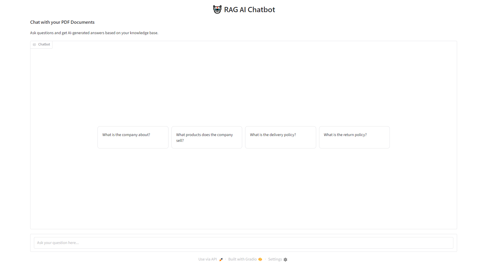

<p align="center">
  
</p>


# 👟 STEPX Footwear – RAG-Based AI Chatbot

An intelligent **Retrieval-Augmented Generation (RAG)** chatbot designed for footwear brand called **STEPX Footwear**. The chatbot uses company knowledge stored in PDF documents to answer customer questions about products, prices, sizes, stock availability, shipping, discounts, returns, refunds, and warranty policies.

The project combines **Python, Ollama, ChromaDB, and Sentence Transformers** to build a document-based AI assistant that retrieves relevant information before generating an answer.

---

## 🚀 Project Overview

Traditional AI chatbots may generate incorrect information or hallucinate answers.

This project uses **Retrieval-Augmented Generation (RAG)** to improve answer accuracy by retrieving relevant information from a custom footwear knowledge base.

### How It Works

1. User asks a question.
2. The question is converted into an embedding.
3. ChromaDB searches for relevant document chunks.
4. Retrieved information is passed to the LLM.
5. Ollama generates an answer based on the retrieved context.
6. The chatbot returns the response to the user.

### Example

**User:**
> Do you have AeroRun Pro in size UK 8?

**AI Chatbot:**
> Yes! STEPX AeroRun Pro is available in Black, UK size 8, with 18 pairs currently in stock.

---

## ✨ Key Features

- 📄 **PDF Knowledge Base:** Uses custom STEPX Footwear business documentation.
- 🔍 **Semantic Search:** Retrieves relevant information using vector embeddings.
- 🧠 **RAG Architecture:** Combines document retrieval with LLM generation.
- 🗄️ **Vector Database:** Stores and searches document embeddings using ChromaDB.
- 🤖 **Local LLM:** Uses Ollama to run an open-source language model locally.
- 💬 **Interactive Chatbot:** Provides a conversational interface using Gradio.
- 🌐 **Multilingual Responses:** Can respond in English, Urdu, and Hinglish when instructed.
- 📦 **Product Information:** Answers questions about products, prices, sizes, and features.
- 📊 **Inventory Information:** Retrieves available stock information from the knowledge base.
- 🚚 **Business Policies:** Answers questions about shipping, payments, discounts, returns, and warranty.
- 🎯 **Context-Based Answers:** Designed to answer using retrieved knowledge instead of inventing business information.

---

## 🏗️ RAG Architecture

```text
             STEPX FOOTWEAR PDF
                     |
                     v
              Document Loading
                     |
                     v
                 Text Splitting
                     |
                     v
              Text Embeddings
                     |
                     v
                ChromaDB
              Vector Database
                     |
                     |
          USER ASKS A QUESTION
                     |
                     v
              Question Embedding
                     |
                     v
             Semantic Retrieval
                     |
                     v
              Relevant Chunks
                     |
                     v
             Ollama LLM Model
                     |
                     v
              Generated Answer
                     |
                     v
               CHAT INTERFACE
```

---

## 🛠️ Technologies Used

| Technology | Purpose |
|---|---|
| Python | Main programming language |
| Ollama | Runs the local language model |
| ChromaDB | Vector database |
| Sentence Transformers | Generates text embeddings |
| Gradio | Builds the chatbot interface |
| PyPDF | Extracts text from PDF documents |
| LangChain (if used) | Document processing and RAG utilities |

---

*Note: Adjust the folder and file names according to your actual project.*

---

## ⚙️ Installation & Setup

This project is developed and executed using **Google Colab**.

### 1. Clone the Repository

```bash
git clone https://github.com/CodingwithFawad/Rag-Project-For-Stepx-Footwear-Brand.git
```

Navigate to the project directory:

```bash
cd Rag-Project-For-Stepx-Footwear-Brand
```

### 2. Open Google Colab

Open the project notebook using Google Colab.

[](https://colab.research.google.com/)

### 3. Install Required Libraries

Run the following command inside a Google Colab notebook cell:

```python
!pip install -q chromadb sentence-transformers pypdf ollama gradio
```

### 4. Install Ollama

Install Ollama using the following command:

```python
!curl -fsSL https://ollama.com/install.sh | sh
```

Check Ollama installation:

```python
!ollama --version
```

### 5. Start Ollama Server

Start the Ollama server using Python:

```python
import subprocess
import time

# Start Ollama server in the background
ollama_process = subprocess.Popen(
    ["ollama", "serve"],
    stdout=subprocess.DEVNULL,
    stderr=subprocess.DEVNULL
)

# Wait for the server to initialize
time.sleep(5)

print("Ollama server started!")
```

### 6. Download the Language Model

Download the Llama 3.2 model:

```python
!ollama pull llama3.2
```

Make sure the downloaded model matches the model configured in the notebook.

### 7. Run the Notebook

Execute all notebook cells in their correct order.

The notebook handles the following processes:

- PDF Document Loading
- Text Extraction and Processing
- Text Chunking
- Embedding Generation
- ChromaDB Vector Database Storage
- Semantic Document Retrieval
- LLM Response Generation using Ollama
- Gradio Chatbot Interface

## 📚 Knowledge Base

The chatbot uses a fictional STEPX Footwear business knowledge base containing:

- Company Profile
- Product Catalogue
- Product Features and Specifications
- Shoe Size Guide
- Product Pricing
- Inventory and Stock Availability
- Discount Coupons
- Ordering Process
- Payment Methods
- Shipping and Delivery
- Return and Exchange Policy
- Refund Policy
- Warranty Information
- Customer Support
- Frequently Asked Questions (FAQs)

This dataset is created for educational and RAG development purposes.

---

## 💡 Example Questions

Try asking the chatbot:

**Products**
- What is the price of AeroRun Pro?
- Tell me about CloudStride shoes.
- Which shoes are suitable for running?

**Inventory**
- Is AeroRun Pro available in UK size 8?
- Which products are out of stock?
- How many StreetFlex Low White shoes are available?

**Discounts**
- How can I get a 10% discount?
- Explain the STEP10 coupon.
- Is free shipping available?

**Policies**
- What is your return policy?
- How long does delivery take?
- What is your warranty period?
- Which payment methods are supported?

**Multilingual**
- AeroRun Pro ki price kya hai?
- UK size 8 available hai?
- Return policy kya hai?

---

## 🔐 Important Notes

- STEPX Footwear is a fictional brand created for learning and development.
- Product information and policies are sample data.
- Ollama models run locally, but model downloads require an internet connection.
- Do not upload private API keys, passwords, or sensitive information to GitHub.
- Avoid uploading large model files and generated vector database files unless specifically required.


If you find this project useful for learning RAG and building AI applications, consider giving it a ⭐ on GitHub.

